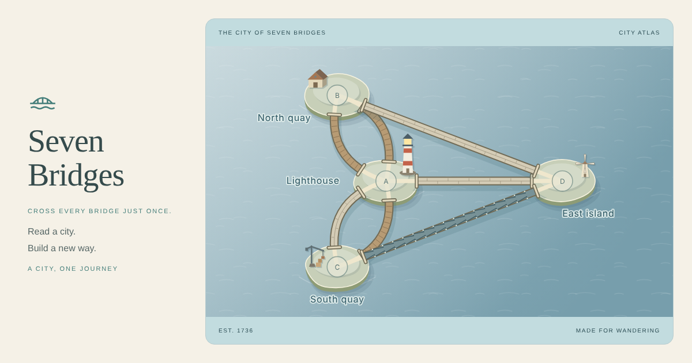

# 七桥漫游 · Seven Bridges

在纸雕水城中走遍每座桥，读懂原版七桥为什么无解，再亲手建设新的归途。独立开发、独立部署；没有运行时网络依赖，也不加载 games 的代码。



- 32 个主线关、四章城市、8 个工程委托
- 点击、沿桥拖动、键盘行走；撤销、分层提示与路线回放
- 城市 / 关系图连续切换；平行桥保留独立身份
- 新建与拆桥、预算与服务区校验、经独立枚举证明的最小改建印章
- UTC+8 每日漫游、周末工程，366 天固定清单（2026-10-12 至 2027-10-12）
- 中英文、明暗主题、默认静音、减少动态、本地版本化存档
- 以 PNG 下载或主动分享路线明信片，默认隐藏路线

## 本地开发

需要 Node.js 22 或更新版本。

```sh
npm ci
npm run dev
```

访问 `http://127.0.0.1:4173`。支持 `?lang=zh|en&theme=light|dark`；有效本地偏好优先，静音不接受入口参数。主线深链例如 `/#SB08`，需要满足章节解锁条件；工程委托为 `/#EC01`，每日为 `/#daily/2026-10-12/walk`。

## 验证与构建

```sh
npm run check
npx playwright install --with-deps chromium
npm run test:browser
```

`check` 包含统一格式、JavaScript 语法、独立运行边界、70 项数学 / 内容 / 持久化测试和静态构建。浏览器检查会通过真实 UI 走完所有可行关，单独完成历史发现，并覆盖回放、输入、存档、日界线、动画取消、320px 布局与 CPU 限速下的模型耗时。截图与测量保存在 `test-results/`，CI 上传为验收附件。

`npm run build` 生成 `dist/` 和完整关卡见证 `content-proof.json`。更新每日清单时执行 `node tools/generators/daily-build.mjs`，审阅排期，运行格式化与全部验收，再发布；构建不会根据当前日期偷偷改题。

## 文档

- [完整设计与持续维护规格](docs/implementation-plan.md)
- [实现、验收与发布记录](docs/release-verification.md)
- [部署与回滚](docs/deployment.md)
- [Mini Games Collection](https://github.com/mingzhangyang/games)

建议正式地址：`https://bridges.orangely.xyz`。正式发布仍需真机和试玩验收；合集外链接入由 games 的独立 PR 完成。
